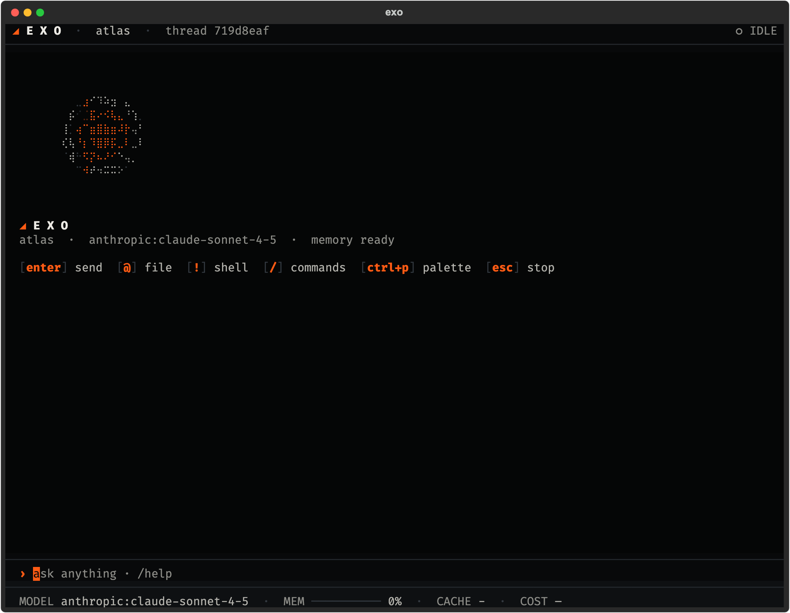
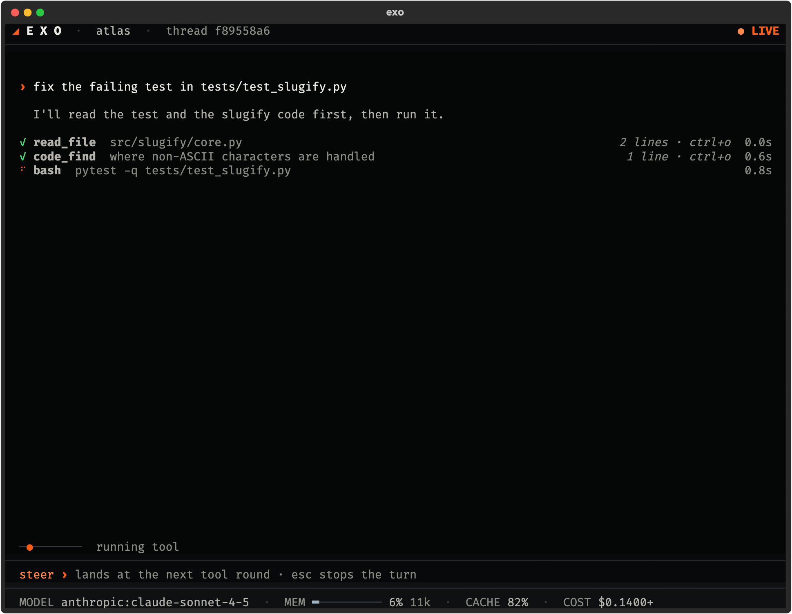
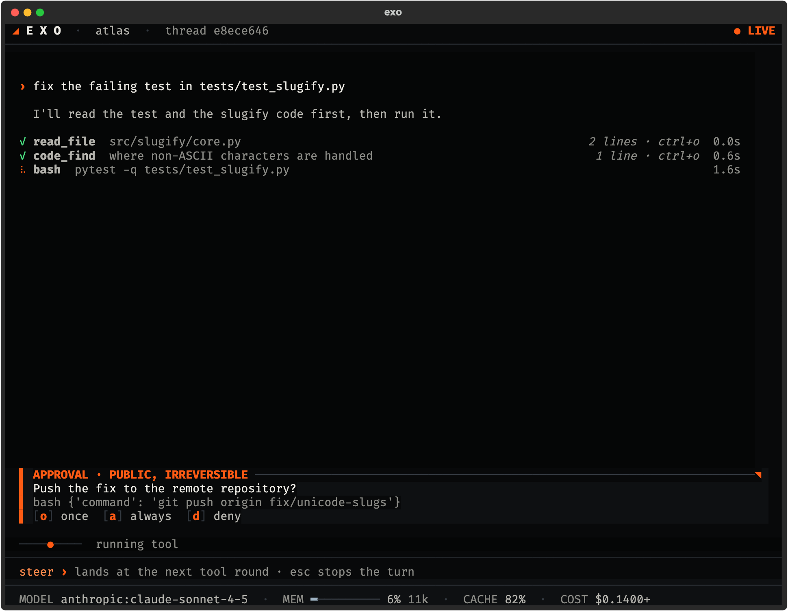
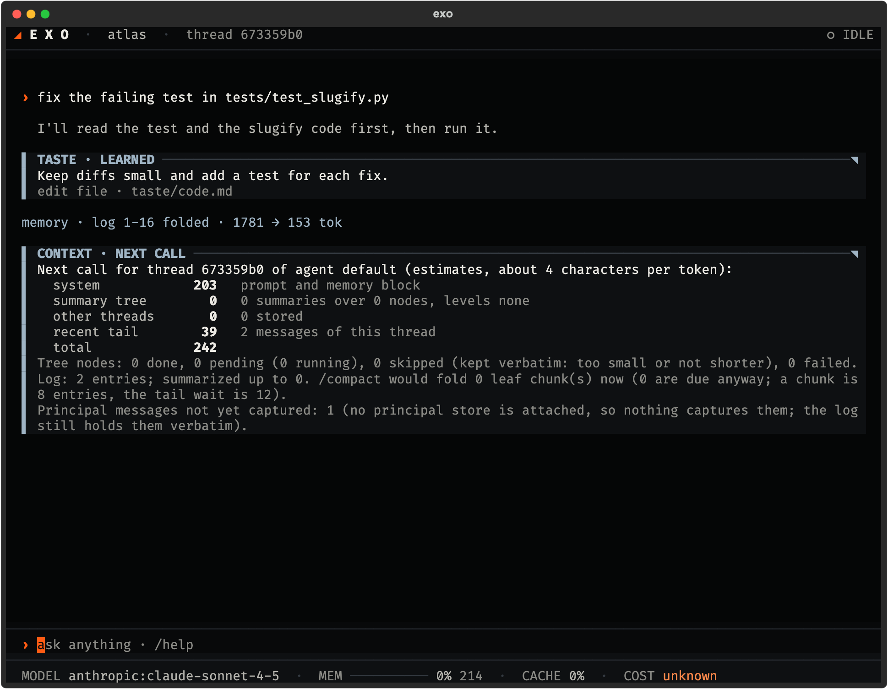
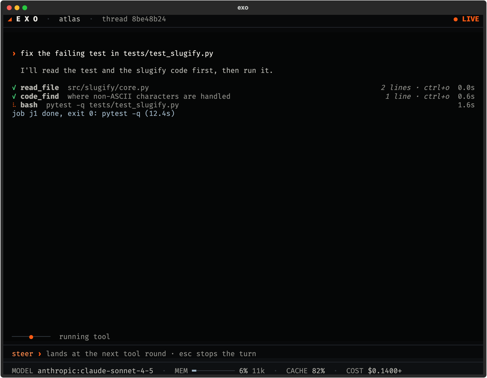
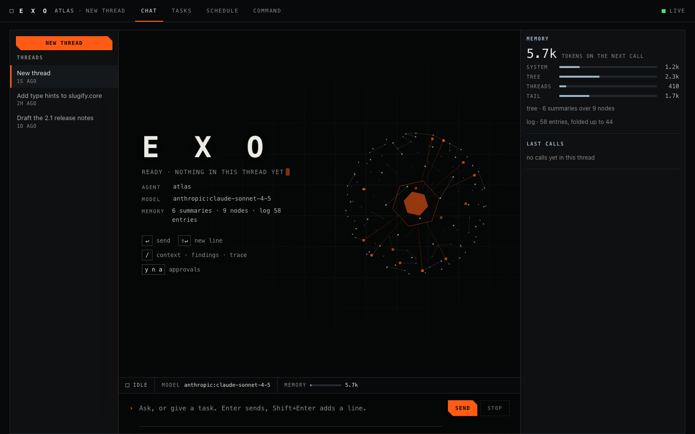
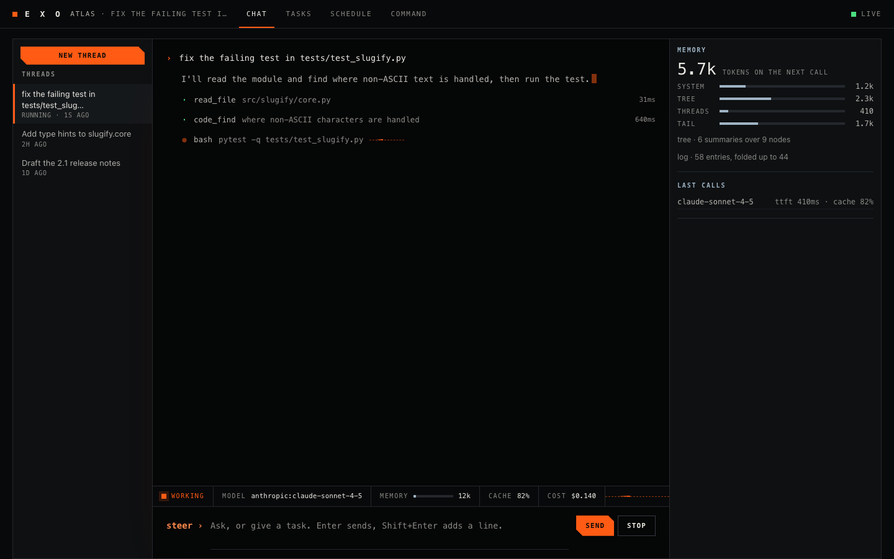
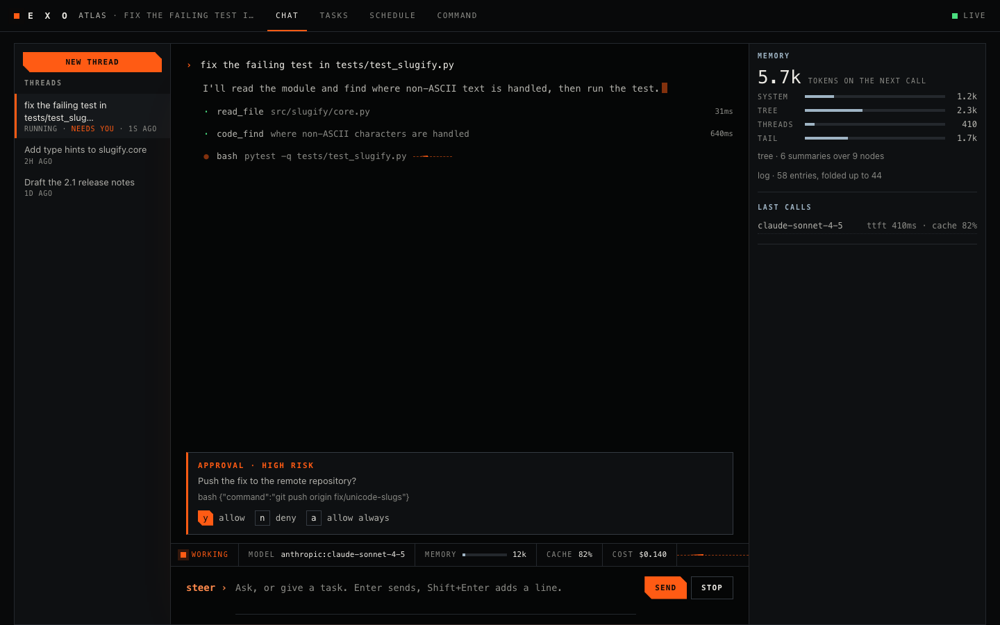
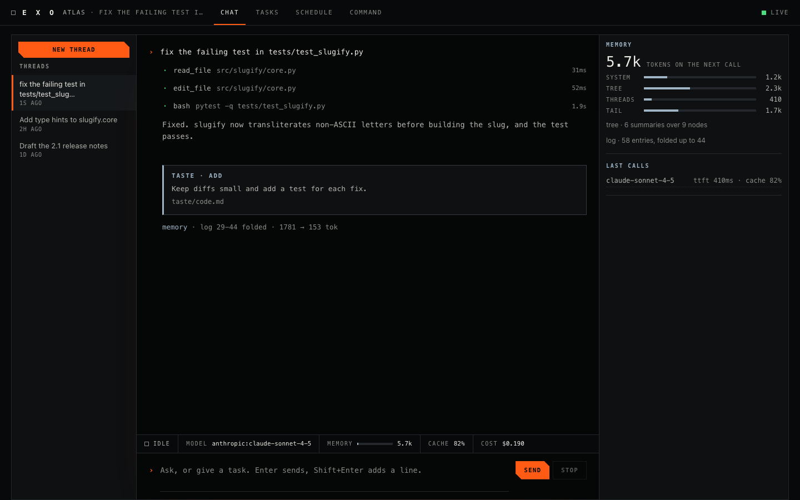

  

# Exo

**Exo is a coding agent for the terminal and the browser that keeps one memory across sessions, ties each
approval to post, send or pay to the exact text you saw, shows the cost of every turn, and runs on your Claude
Code login or an API key.**

It reads and edits files and runs commands in the folder you start it in. The
[glossary](docs/USER-GUIDE.md#words-exo-uses) explains the few words Exo uses in its own way.

Exo is a standalone agent system for working well with language models. You talk to one agent. It keeps one
continuous memory across every window, channel and scheduled run, so a new thread is not a blank mind. It
records how it performs (which model served each call, how long it took, what it cost) and turns that record
into findings it can verify. Anything that posts, sends or pays waits for your answer, and the answer is tied
to the exact text. It runs in a terminal and in a browser, on the same core.

Exo is early and in active build. Waves 1 to 3 are built and in daily use on one agent. See
[`DECISIONS.md`](DECISIONS.md) for every significant choice, with the reason and what was rejected.

  

## What is in it

| | |
|---|---|
| **One agent, one memory** | A seat is one agent with one append-only, hash-chained log and one summary tree. Windows, channels, scheduled runs and peer messages are threads of it. `/context` shows what the next call carries. [`docs/MEMORY-MODEL.md`](docs/MEMORY-MODEL.md) |
| **A harness that watches itself** | Every model call records its route, timing and cost. Anomaly rules turn the trace into findings. A finding marked fixed is measured again and reopens if it returns. [`docs/TRACE.md`](docs/TRACE.md) |
| **A gate with exact-text approvals** | For outward acts the gate hashes the exact text, target and arguments. Edit one character and it asks again. Seats sign their answers, and standing grants belong to the principal and expire. [`docs/GATE.md`](docs/GATE.md) |
| **Background jobs** | A long build or test run does not hold the turn. It is a job the agent owns, and the agent gets a notice when it ends. [`docs/JOBS.md`](docs/JOBS.md) |
| **Peers** | Sessions message each other through one ingress path with a trust policy. A peer message is input, never consent. [`docs/PEERS.md`](docs/PEERS.md) |
| **Cost per turn** | Timing and estimated cost for every turn and call. A call Exo cannot price reads `unknown`, never zero. |
| **Two clients** | A terminal client (`exo`, the same as `exo tui`) and a web client (`exo web`), both drawn from one protocol and one design language. [`docs/UI.md`](docs/UI.md), [`docs/ui/WEB.md`](docs/ui/WEB.md) |
| **Fits one person, works for anyone** | The core is generic. Everything about a person lives in their own store, built by an onboarding interview. A fresh install with an empty store runs end to end. |

Also built: a signed ledger and personal store, a learning loop with explicit promotion rules and a gated
path that uses held-out evaluation, decision models for small choices, subagents on the cheapest model that
can do the job, and a provider-agnostic model router with fallback. Other promotion paths use principal
rulings or repeated, high-confidence evidence.

The opt-in [`exo improve --offline` command](docs/integrations/HARNESS2.md) runs
Harness² experiments on explicit public fixtures, checks disjoint held-out tasks,
and exports typed proposals and evidence for review.

## Screenshots

These are historical screenshots driven by scripted test data for a demo agent named `atlas`, fixing a failing
test in a small library. They may not show current controls or the default layout; the older approval image
still shows the former Esc stop hint. The main terminal screenshot set uses the classic layout; the separate
D-046 inverse-layout example is listed in [`docs/media/README.md`](docs/media/README.md).

**Terminal client**

| Start | A turn with tools |
|---|---|
|  |  |
| **Approval** | **`/context`** |
|  |  |

**Web client**

| Start | A turn |
|---|---|
|  |  |
| **Approval** | **Memory column** |
|  |  |

More on each client: [exo.askaconsult.com/cli](https://exo.askaconsult.com/cli/) and
[exo.askaconsult.com/app](https://exo.askaconsult.com/app/).

## Quick start

The repository is public and remains an early preview. Exo needs `git` and Python 3.11 or newer, on macOS or Linux
(tested on Arch with Python 3.14).

    git clone https://github.com/Moissanite-Labs/exo && cd exo
    scripts/install.sh --dry-run      # print the plan, change nothing
    scripts/install.sh                # install: puts `exo` on your PATH (~/.local/bin/exo)
    exo                               # the terminal client, in the current directory

If `~/.local/bin` is not on your PATH, the installer prints the line to add to your shell rc file (or run it
with `--modify-path` and it adds the line). With no model key, Exo uses your Claude Code login when the `claude`
command is on your PATH: the model is `claude-cli:sonnet`, and cost reads `unknown` because a subscription has
no per-call price ([`docs/PROVIDERS.md`](docs/PROVIDERS.md#use-your-claude-code-login-claude-cli)). Otherwise,
the first run with no model key says so in a note and opens the providers panel. If one provider is set up but no
main model is chosen, the model picker opens instead. Type `/providers` to open the panel again. Upgrade with
`exo update`.
`exo --version` shows the version and, for a checkout install, the git sha. Flags pass through to the client:
`exo --resume` (or `exo resume`), `exo --seat NAME`, `exo --no-intro`. Other commands keep working:
`exo models`, `exo providers`, `exo -h` lists all.

For the web client, run `exo web`. It opens the page in your browser. If it does not, open the full link it
prints, `http://127.0.0.1:7342/#token=...`: the part after `#token=` is a key for this launch, and the bare
address shows only a note. `exo web` starts the shared core if none runs, and `exo stop` ends it.

Options, what each install step does, safety rules and re-runs are in [`docs/INSTALL.md`](docs/INSTALL.md). To
add a model key, see [`docs/PROVIDERS.md`](docs/PROVIDERS.md). Provider keys are read from the environment
first, then the macOS Keychain or Linux Secret Service (when `secret-tool` is available), then a mode-0600
`keys.env` file. `EXO_KEYS_FILE` can point to another file.

The first time `exo` runs on an `EXO_HOME`, the agent gives a short orientation (`/intro`) and turns on
tutorial mode: small tips the first time something comes up. `/tutorial off` turns them off, and
`exo --no-intro` skips the orientation. Details in [`docs/ONBOARDING.md`](docs/ONBOARDING.md).

Commands you will use in the terminal (`/help` lists all): `/new`, `/sessions`, `/fork`, `/undo`, `/cwd`,
`/context`, `/compact`, `/model`, `/default`, `/usage`, `/trace`, `/findings`, `/peers`, `/send`, `/handoff`,
`/intro`, `/tutorial`.

## Versions

Exo 0.2.0 (egg). Each major version has a codename from the exopet line: egg, cell, tile, cube, frame, then 4D and up.
See [`CHANGELOG.md`](CHANGELOG.md) and [`docs/VERSIONING.md`](docs/VERSIONING.md).

## Read on

| | |
|---|---|
| [`docs/USER-GUIDE.md`](docs/USER-GUIDE.md) | Using Exo day to day |
| [`docs/DEVELOPER-GUIDE.md`](docs/DEVELOPER-GUIDE.md) | Building on Exo: the protocol, plugins, tools, tests |
| [`docs/REPOSITORY-WORKFLOW.md`](docs/REPOSITORY-WORKFLOW.md) | Where changes belong, reviewed desktop syncs and the transition from paired PRs |
| [Whitepaper](https://exo.askaconsult.com/whitepaper/) | How each part works and why, with the trade-offs |
| [`docs/DOCS-MAP.md`](docs/DOCS-MAP.md) | Index of every doc, and what is still missing |
| [`docs/ARCHITECTURE.md`](docs/ARCHITECTURE.md) | Components, memory and context model |
| [`DECISIONS.md`](DECISIONS.md) | Every significant choice, why, and what was rejected |
| [`docs/media/README.md`](docs/media/README.md) | How the images and animations are made |

Folders: `src/` the core, `clients/tui/` the terminal client, `plugins/` memory, context, gate, bus, command
centre and orchestra, `research/` the groundwork, `site/` the project website.

## Two goals, held together

- **Fit one person as closely as possible.** The first principal is the project's author.
- **Replicate for anyone.** The core is generic. Everything about a person lives in their own
  principal store. See `DECISIONS.md` (D-004).

## Credits and inspirations

- [dzhng/jevgrep](https://github.com/dzhng/jevgrep) (MIT): the `jg` code search behind the `code_find` tool and
  the `jevgrep` skill (D-029).
- [Hermes Agent](https://github.com/NousResearch/hermes-agent) by Nous Research (MIT): Exo lifts parts of it,
  with credit and provenance (`PROVENANCE.toml`).
- Victor Taelin and Higher Order Company, [OptChat and UniiChat](https://uniichat.com): the word-for-word log
  and summary tree behind Exo's memory. Exo reimplements the ideas, not the code.
- [opencode](https://opencode.ai), [Command Code](https://commandcode.ai), [Letta Code](https://github.com/letta-ai/letta-code),
  and Gwern Branwen's ["Guardian Angel"](https://gwern.net/guardian-angel): ideas for the surface, taste and memory.

The full list, with how each source applies, is on the [project site](https://exo.askaconsult.com/#credits).

Built by [Aska Digital](https://digital.askaconsult.com).
